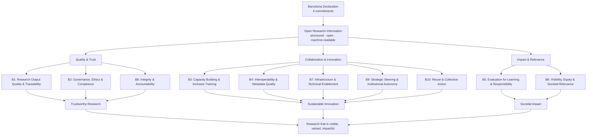

# The Ten Benefits of Open Research Information

Generated from `site/data/taxonomy.json` (brief v0.3) by
`scripts/generate-diagram.mjs`. Do not edit by hand; edit the JSON and regenerate.

Read top to bottom: the commitments of the Declaration, open research information, the
ten benefits in their three axes, the three outcomes and the vision. The description of
each benefit and who benefits from it are in
`ORI_Benefits_Overview_brief.md`.
